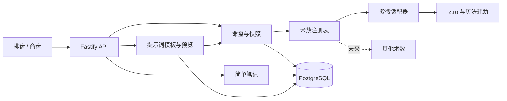

# 东玄架构：命盘与笔记

## 1. 结构保持简单

沿用现有 React + Fastify + PostgreSQL 单体及 pnpm workspace，不更换框架，不增加队列、微服务或通用插件平台。

业务包括命盘记录/快照、简单笔记和提示词模板；紫微模块负责计算和展示。一张命盘就是一个人。此前客户/案例/回访模型撤销，不创建 `clients`、`cases`、`case_entries`、`case_chart_refs` 或单独的人物档案表。

建议目录：服务端 `charts/`、`notes/`、`prompts/`、`divination/ziwei/`；前端对应盘面和笔记组件。继续使用 `packages/dto` 分享输入与输出契约。只在真正复用时再抽新的 workspace 包。

## 2. 通用与紫微的边界

通用层负责身份、所有权、保存、查询、搜索和关联。紫微模块负责输入验证、规则、星曜、运限分段和文字输出，不能读写用户资料或数据库。

`SystemId` 可以列出 `ziwei | bazi | meihua | qimen`，但当前计算结果创建 schema 只接受 `system: 'ziwei'`。八字、奇门注册为 `planned`；梅花入口开放原始草稿，但计算 adapter 尚未就绪，结果创建 API 同样拒绝起卦请求。原始输入不写成已计算快照。未来各术数定义自己的输入和结果，不能强制梅花或奇门具备生日与十二宫。

计算结果由服务端生成，前端不自行排星。结构化结果与文字来自同一份结果；直接使用的历法辅助依赖需显式声明和锁定。技能只作为实现和测试参考，部署不调用本机技能路径。

## 3. 最小数据模型

保留 `users`、`oidc_identities`。新增或演进：

| 表 | 关键字段 | 规则 |
| --- | --- | --- |
| `charts` | `id, user_id, title, relation?, remark?, calendar, date_str, time_index, gender, system, archived_at, created_at, updated_at` | 一张命盘就是一个人。称呼、关系、备注和出生资料都在盘上 |
| `chart_snapshots` | `id, chart_id, user_id, kind, base_snapshot_id?, input, rules, engine_meta, schema_version, query?, result, text, summary, provenance, created_at` | `base` 基础快照、`view` 派生视图；在紫微中对应本命与运限 |
| `notes` | `id, user_id, chart_id?, snapshot_id?, body, created_at, updated_at` | 恰好关联一张命盘或一份已保存的盘面；简单编辑删除，不做咨询状态和修订链 |
| `prompt_templates` | `id, user_id, system, title, body, inputs_schema, data_requirements, variable_schema_version, revision, created_at, updated_at` | 模板保存指令、字段定义和资料要求，本次输入与绑定单独传入；使用 revision 做并发更新检查，不保存展开后的命盘资料 |

约束：

- 每张 chart 仅有一个 `kind=base`，对这一条件建立 `chart_id` 唯一约束；不能对所有 `(chart_id, kind)` 唯一，否则无法保存第二个运限视图。
- `view` 通过 `base_snapshot_id` 绑定同一张盘的基础快照，不能引用另一派生视图。不同查询有独立快照 ID。
- `notes` 的 `chart_id` 与 `snapshot_id` 二选一。命盘页在没有打开已保存运限时显示这张盘的笔记；打开已保存运限时显示那一份盘面的笔记。
- 所有外键关联验证当前账号所有权，必要时使用组合外键；不能只信客户端传来的 ID。
- 名称、备注、笔记可编辑。改正出生资料会重算同一张盘的本命，并清掉还没有笔记的运限。运限上已有笔记时拒绝改正。
- 归档不删除盘或笔记。被笔记引用的盘/快照禁止级联删除；删除时提示先处理引用，保留归档替代操作。
- 删除命盘前要先处理盘上和运限上的笔记；不能默默级联丢掉记录。账号整体删除如未来提供，另行定义事务处理。
- 常用索引以 `user_id` 起始，列表使用稳定排序及分页。个人小规模先用数据库搜索，不引入搜索服务。

“自己”只是可选关系标识，不等于登录用户资料；不自动把第一张盘当成用户真实出生信息。

## 4. 输入、规则与版本

保存原始历法、日期、闰月、性别、时辰/钟点、输入精度及规范化 `timeIndex`。用户原始出生日期与晚子换日后的计算日期分开保存。保存 HH:mm 不代表引擎使用了分钟级交节算法，必须另存计算精度/取样口径。

快照包含 iztro、历法辅助库、适配器和文字格式版本，实际 `yearDivide / horoscopeDivide / ageDivide / dayDivide / algorithm / fixLeap` 等规则，结构化结果、两套四柱、文字和列表摘要。

仅存版本号不足以保存历史，必须存实际输出。旧引擎不可用时，旧快照仍可读；若需要新的运限查询，应明确复制成新版本盘，不能偷偷换引擎。

月份结果用 `segments` 保存覆盖段、农历标签和视图引用，用 `views` 保存去重后的实际运限结果。农历整月范围、实际流月有效范围、整套叠盘有效范围分别表达。详见 [紫微规则](ziwei-rules.md)。

## 5. API 方向

现有账号接口不变。新契约可放 `/api/v2`，过渡期保留旧 API 兼容层。

| 接口 | 用途 |
| --- | --- |
| `GET /api/v2/systems` | 紫微计算可用；梅花原始输入可用但计算待接入，八字/奇门规划中 |
| `GET/POST /api/v2/charts` | 全部命盘、按称呼或关系搜索、归档筛选、创建基础盘 |
| `GET/PATCH/DELETE /api/v2/charts/:id` | 读取快照、改称呼/关系/备注/归档/恢复、按引用约束删除 |
| `POST /api/v2/charts/:id/revisions` | 改正这张盘的出生资料并重算，不另起一张 |
| `POST /api/v2/charts/:id/views/preview` | 运限预览，不自动保存 |
| `GET/POST /api/v2/charts/:id/views` | 已存运限列表、保存当前视图，无需案例 |
| `GET /api/v2/snapshots/:id` | 按准确 ID 重开盘面 |
| `GET/POST /api/v2/notes` | 按命盘或已保存盘面查询/创建笔记 |
| `PATCH/DELETE /api/v2/notes/:id` | 编辑/删除笔记；不改变快照 |

所有接口鉴权和所有权校验。无权访问的资源按未找到处理；不能从笔记、摘要或预览绕过权限。

预览返回可校验凭证，绑定账号、基础快照、规范化查询、全部计算版本、结果指纹及有效期。保存时保存服务端暂存的相同结果，或用同一身份重算并核对；版本变化或过期要求重新预览，不接受浏览器上传的计算结果。创建/保存支持账号与操作范围内的幂等键。

命盘和笔记编辑使用简单版本号检查冲突，避免双标签页互相覆盖；无需增加笔记版本历史表。月查询首版建议最多 12 个阳历月；不合法/不支持区间按规则文档明确拒绝。

## 6. 迁移现有命盘

### 冻结与来源

修改现有 renderer 前先冻结旧实现、锁文件、配置和合成样例，建立独立 legacy 重建入口。现有库只有输入，没有创建时结果，所以只能标记“迁移时按既有逻辑重建”，不能声称还原用户当年看到的原始盘。

### 迁移步骤

1. 引入有版本记录的迁移机制；现有 `CREATE TABLE IF NOT EXISTS` 不足以承担数据演进。备份并演练恢复。
2. 增加通用字段和快照表，旧出生字段暂时保留；类型回填紫微、人物关联留空。
3. 采用小站维护窗口，暂停所有旧实例的命盘写入口，包括新建、修改和删除。
4. 用冻结入口分批回填基础快照；仅基础快照条件唯一，支持中断重试。
5. 核对总数、成功/失败数量和遗漏记录；失败记录保留输入，并在列表显示待修复，不能静默排成空盘。
6. 切换读取和兼容写入，再恢复写操作。旧出生列仍为 NOT NULL 时，新旧 API 在同一事务写旧列和新快照。
7. 保持原 `/charts/:id` URL 和 ID。旧的人物资料并进已关联的那张盘；没有命盘的人物不另造出生资料。不按名字自动合并。
8. 回滚观察期后再移除旧列与兼容 API；不要在首次迁移就清理。

若必须不停机，应先完整部署原子双写，再回填和核对增量，不能边运行只写旧表的服务边宣布迁移完成。切换后有新数据时，回滚需使用能理解新结构的兼容版本，不能盲目回退导致新盘或笔记丢失。

## 7. 未来扩展保持在边界上

现在保留 system 标识、独立输入/结果和术数入口状态，并开放梅花独立原始输入页。未来接入八字、梅花、奇门计算时，接入自己的引擎、表单和盘面，复用命盘记录和笔记，不新建一套“客户系统”或人物表。

专注看盘只是前端展示模式：隐藏导航和私人笔记，不改变数据权限，不发起共享。AI、公开分享或团队协作另行设计，本期不创建相关数据表和依赖。

## 8. 提示词预览与梅花扩展

提示词模块负责变量校验、模板保存、取数编排和纯文本替换，不参与排星或起卦。通过术数专属变量处理器访问已有基础快照与运限结果；不读取命盘备注或笔记。月份查询复用紫微分段逻辑，不能再写一套简化历法。

模板正文不作为程序执行，不使用 eval、动态属性遍历或网络指令。正文和问题中的标记只替换一次，引用内容不递归解析。预览绑定模板 revision、命盘/视图身份、规则与查询指纹；上下文变动后旧预览失效。复制仅在客户端进行，无外部 Agent 调用。

模板 system 接受 `ziwei` 与 `meihua`，用于归类；生成按实际资料依赖判断。纯填写模板不需要命盘；需要梅花计算结果的模板在 resolver 未就绪时明确阻断。`profile.name` 与 `profile.gender` 仍是模板变量名，取值来自所选命盘的称呼和性别。紫微、八字和卦例通过显式 bindings 引用，逐一核对所有权，不以生日或同名自动拼接。八字当前未接入，不能以紫微四柱替代。未来梅花输入应独立包含原始占问、起卦方式、取数、时间/时区、规则，结果包含本卦、互卦、变卦、动爻、体用与推导依据；不要求生日。可选关联一张命盘。

本次填写按 inputs_schema 验证类型与必填策略；选填现实信息标为未提供，必要计算资料缺失则阻断。当前/下一大限绑定 asOfDate；多年和月窗口各自查询并校验完整状态段，不能用某天结果冒充全年。梅花原始草稿包含问题、数字与可选命盘，不依赖生日，也不冒充计算结果；生产草稿持久化独立于 chart_snapshots，HTML 原型仅会话内存。

接口、数据契约及验收见 [提示词与命盘引用](prompt-templates.md)。原型使用浏览器存储保存模板只是演示方案，正式站点使用账号下的数据库记录。
