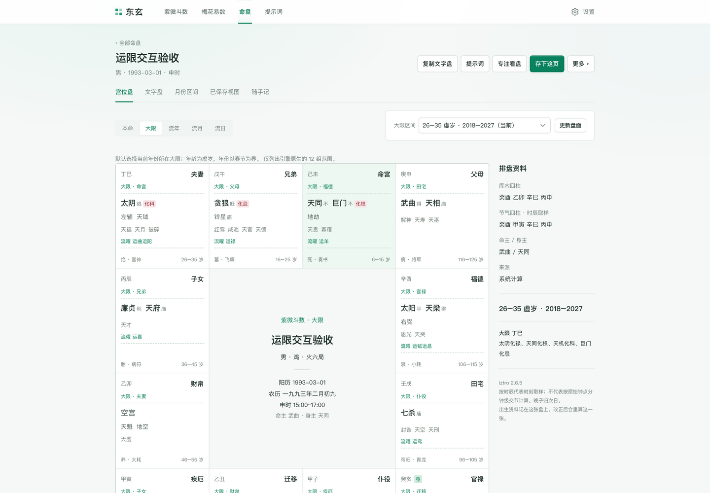
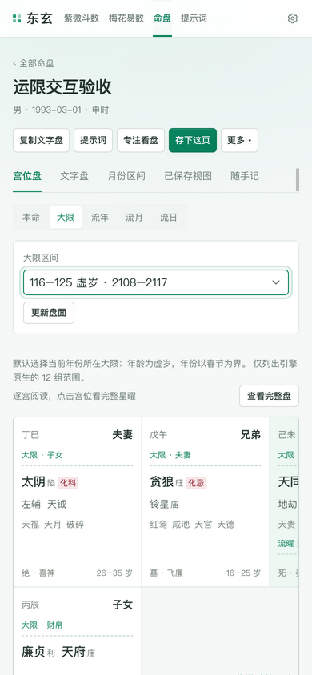
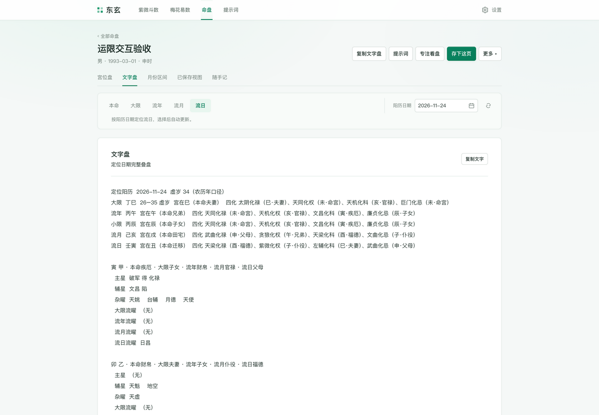
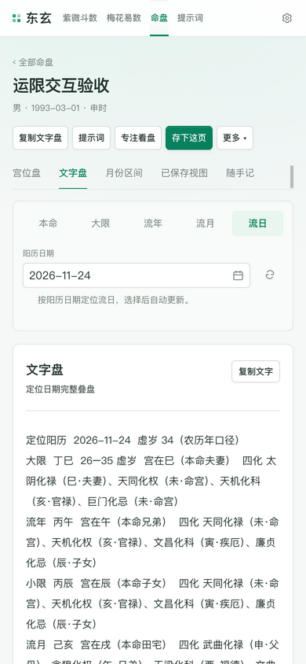

# 运限选择交互调整

2026-11-24。按用户确认，只提供 iztro 2.6.5 原生可计算的大限，不外推到 150 岁。

| 层级 | 选择控件 | 行为 |
| --- | --- | --- |
| 大限 | 虚岁范围 + 农历年份范围 | 原生 12 组区间，默认当前年份所在大限；未起限时显示童限 |
| 流年 | 农历年份 | 春节换年，不再要求填写月、日 |
| 流月 | 农历年份 + 实际流月 | 展示对应阳历日期范围；闰月按引擎规则分上下半月 |
| 流日 | 阳历日期日历 | 一个完整日期控件 |

切换层级或选项后自动更新盘面。刷新按钮可重试当前选择；连续快速切换时仅采用最新结果。

共享下拉框箭头改为固定尺寸、垂直居中的 SVG，消除字符箭头的字形基线偏移。

## 数据来源与兼容

- `flow-options` 接口校验登录、命盘归属和引擎版本，从同一命盘的 `decadalList()` / `monthlyList()` 提供选项。
- 大限采用新增 `mode: decadal, startAge`，直接投影对应原生区间的十二宫、四化和流曜，不借用某天的小限计算。因而最后一个原生大限的年份即使超过日历查询上限，也可完整展示。
- 日期叠盘继续遵守现有日历和 1–120 虚岁边界。出生年采用引擎原始农历年份，覆盖除夕晚子时跨年的情况。
- 保存视图仍保留精确查询和完整 JSON 结果，不修改基础快照；重新打开大限保留所选区间，旧童限保留原日期。无需数据库结构迁移。
- 提示词来源展示新大限的年龄和年份区间；日期类引用不会把所选大限误当成基准日，可使用已有的“改用基础命盘”重新取数。

## 验证

- `pnpm test:local`：56 项通过，含隔离 PostgreSQL 的归属校验、保存及读取、基础快照不变、提示词绑定冲突。
- `pnpm test:prompts`：43 项通过，含请求竞态、切换命盘、重新打开大限及旧童限、保留旧盘更新和失败后的操作限制。
- `pnpm typecheck`、`pnpm build`、统一 UI 控件检查通过。
- 运限原生对照覆盖全部 12 组大限、春节换年、闰月分段、出生日期和日历端点、除夕晚子时。
- 本地浏览器使用合成账号验收大限默认值、最后一组大限的实际渲染与保存，以及桌面和手机布局；切换流年、流月、流日后分别显示一个下拉框、两个下拉框、一个日历，均无错误。

## 线上发布

- 源码提交：`bccd92226c9576bb0fd31adfd52e6335a3a1c77f`。
- [GitHub Actions 发布](https://github.com/ximing/dongxuan/actions/runs/45380839268)的检查、镜像构建、部署三个任务全部成功。
- 镜像：`ghcr.io/ximing/dongxuan@sha256:6f10412ac6b12023a2158ee06a84bb956dc9283be1f66a9de9abf9c589c21bda`，容器健康状态为 `healthy`。
- HTTPS `/health` 正常；新增选项接口未登录返回 401；一键登录状态仍为开启。
- 已核对入口实际提供的新 JS / CSS 包含四类选择控件及居中 SVG 箭头，应用近期日志无错误级别记录或 5xx。

## 切换时保持布局稳定

切换时不再插入页头整条计算提示，也不清空正在阅读的盘面。新结果返回前，保留原层级的盘面、侧栏及文字；返回后整体替换。旧结果只用于过渡展示，更新期间和更新失败后不能当作新选择复制、保存或生成提示词。切回本命、改正出生资料、离开命盘时清除过渡结果。

“存下这页”始终保留位置，更新按钮文字保持不变；计算进度、保存反馈和范围说明共用固定高度的状态栏。手机选择区采用固定网格和图标刷新按钮，避免控件换行带动盘面移动。重复点击已经选中的层级不会重新请求。

使用本地合成命盘，暂缓预览响应后检查加载前、中、后的布局：[坐标记录](validation/chart-stable-loading.json)。桌面 1440px、手机 390px 与 360px 三组检查中，盘面顶部、工具栏和页头高度均保持不变；加载中显示原层级，返回后显示新层级。

新增测试覆盖层级切换保留整张旧盘、年份选项与预览两阶段更新、失败后保留显示并禁止误存、切回本命丢弃晚到响应、打开保存视图期间保持原盘。类型检查、43 项前端测试和生产构建通过。

源码 `29df01777eb85ec19c75eda7a1acb0063bd8ff92` 已经由 [GitHub Actions](https://github.com/ximing/dongxuan/actions/runs/45387047335) 发布。线上镜像为 `sha256:49a0eb7486b8f87f99fa7c70961d11fe21424b0b57c099ba31c5c384ab561ef5`，容器及 HTTPS 健康检查正常；实际 JS/CSS 已核对包含保留旧盘、固定状态栏和手机网格，原页头 loading 文案已移除。近期应用日志无错误级别记录或 5xx。

## 工具栏视觉整理

根据文字盘截图反馈，将层级切换、日期或范围选择、刷新和说明合并为统一的浅色工具栏。取消日期区独立白框，刷新统一使用带名称和悬浮说明的图标按钮；说明和更新状态放在工具栏底部。工具栏与正文在桌面保留 20px、手机保留 16px 间距。

手机采用层级选择与查询字段两行布局，五个层级等宽，年份和月份保持在一行。层级按钮提供 `aria-pressed` 状态。保留之前的旧盘过渡、操作禁用和固定状态栏逻辑。

生产构建及统一控件检查、现有 43 项前端测试通过。[浏览器坐标记录](validation/chart-toolbar-layout.json)覆盖 1440px、390px、360px：切换加载前、中、后的工具栏高度和文字盘顶部位置一致，页面没有横向溢出。

